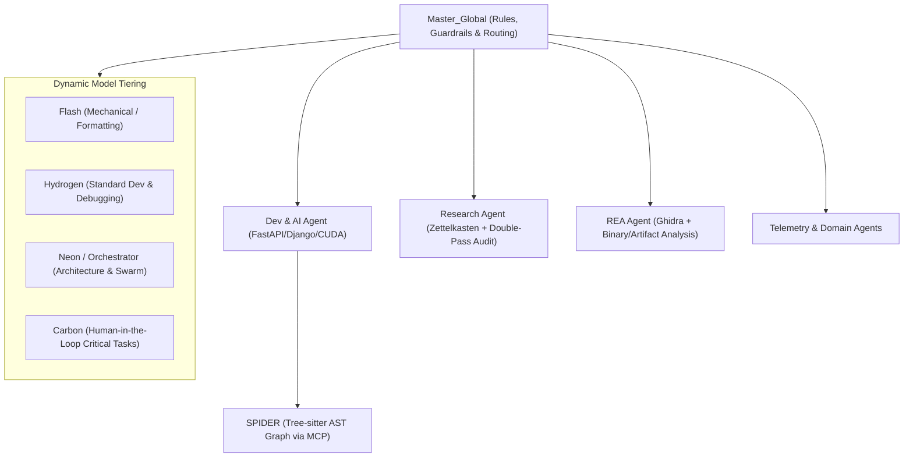

# Hi, I'm Carlos (`carcangar02`) 👋

Computer Engineering student & **AI / Full-Stack Developer** based in Madrid, Spain.  
Focused on **production web backends**, **3D/GPU-accelerated tooling**, and **multi-agent AI orchestration**.

---

## 🚀 Featured Projects

| Project | Stack | Description |
| :--- | :--- | :--- |
| **[NORNAS](https://github.com/carcangar02/NORNAS)** | `FastAPI` `React` `TypeScript` `Three.js` `XPBD` `CuPy` | Modular 3D garment pattern & cloth physics simulation studio with plugin architecture and optional CUDA acceleration. |
| **[ibi_clausus_crm](https://github.com/carcangar02/ibi_clausus_crm)** | `Django 5` `PostgreSQL` `Docker` `ReportLab` `WeasyPrint` | Full-stack CRM for music band operations: attendance, allowances/mileage, PDF generation, and treasury balances. |
| **[inmo_leadflow](https://github.com/carcangar02/inmo_leadflow)** | `FastAPI` `Pydantic` `SQLite` `Tailwind` | Real-estate lead capture & qualification engine with 0–100 scoring and commercial dashboard. |
| **[atenea](https://github.com/carcangar02/atenea)** | `Python` `faster-whisper` `CUDA` `sounddevice` | Local GPU-accelerated lecture recorder, speech-to-text (`large-v3`), and structured Markdown summarizer. |
| **[CarcanBooks](https://github.com/carcangar02/CarcanBooks)** | `Python` `Django` | Personal digital library and book management platform. |

---

## 🤖 Multi-Agent Orchestration System

Beyond individual apps, I design and run a **role-based multi-agent workflow** built around strict guardrails, cost/latency model routing, and persistent graph memory:

* **Role Specialization**: Isolated agent profiles inheriting global engineering standards, automatic domain activation, and isolated `venv` / `.gitignore` enforcement.
* **Dynamic Model Routing**: Tasks are routed across lightweight (`Flash`), standard (`Hydrogen`), reasoning (`Neon` / `Orchestrator`), and gated (`Carbon` with explicit human approval) tiers.
* **Dual Persistent Memory**: Codebase AST knowledge graphs (`codebase-memory-mcp` / Tree-sitter) paired with structured Zettelkasten documentation and double-pass gap auditing.
* **Safety Guardrails**: Diff-before-edit confirmation, automated secret/artifact exclusion on Git pushes, and evidence-first reporting in reverse-engineering workflows.

---

## 🛠️ Core Stack

* **Backend & APIs**: Python, FastAPI, Django, PostgreSQL, SQLite, Docker
* **Frontend & 3D**: React, TypeScript, Three.js, Tailwind CSS
* **AI & GPU**: Multi-Agent Orchestration, MCP, `faster-whisper`, CUDA / CuPy
